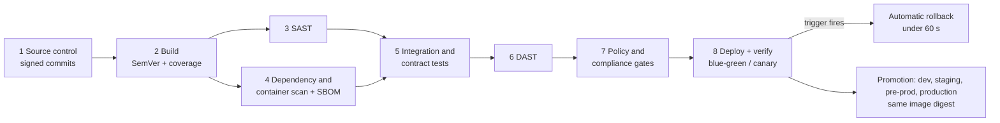

# DOC5A-CICD-Pipeline-Manyashree

**Zero-downtime CI/CD pipeline with compliance gates for NovaPay Digital Bank (fictional, RBI-licensed)**
Author: Manyashree U | Track: DevOps & Cloud Engineer | Programme: ZeTheta 15-day project

## Executive summary
NovaPay deploys by manual SSH every two weeks, recovers from incidents in 4.5 hours, has no automated compliance scanning, and has 17 open RBI non-conformances. This repository is a design-and-configuration package that replaces that with an eight-stage pipeline: source control, build, SAST, dependency and container scanning, integration and contract testing, DAST, policy and compliance gates, and deployment with verification.

Blue-green and canary releases run on Istio, with three categories of automatic rollback (immediate, escalated, manual). Database changes follow expand-contract so rollback never needs a schema change. Compliance gates have numeric thresholds, exception workflows and audit records mapped to RBI and PCI-DSS v4.0. Four environments promote one signed image by digest; only configuration changes. Runbook, incident playbook, DORA metrics and dashboards complete the operating model.

The standard path is estimated at about 1 hour 46 minutes commit-to-production, and a pre-approved "fast lane" at about 56 minutes. These are design estimates, not measurements.

**What is verified and what is not:** the canary analysis script, Helm chart rendering and YAML/JSON syntax were run. OPA policies, alert rules, the emergency rollback script, Terraform plans and dashboards were **not** run against real systems; see [self-assessment](evidence/self-assessment.md).

## Architecture overview

Full architecture, stage specifications and timing: [Deliverable 1](docs/01-pipeline-architecture/architecture.md).

## Table of contents
| # | Deliverable | Where |
|---|-------------|-------|
| 1 | Pipeline architecture (8+ stages) | [docs/01-pipeline-architecture/](docs/01-pipeline-architecture/architecture.md) |
| 2 | Blue-green and canary strategies | [docs/02-deployment-strategies/](docs/02-deployment-strategies/deployment-strategies.md) |
| 3 | Compliance gates (RBI, PCI-DSS) | [docs/03-compliance-gates/](docs/03-compliance-gates/compliance-gates.md) |
| 4 | Zero-downtime database migration | [docs/04-database-migration/](docs/04-database-migration/migration-strategy.md) |
| 5 | Environment promotion workflow | [docs/05-environment-promotion/](docs/05-environment-promotion/environment-promotion.md) |
| 6 | Automated rollback specification | [docs/06-rollback-specification/](docs/06-rollback-specification/rollback-specification.md) |
| 7 | Runbook and incident playbook | [runbooks/deployment-runbook.md](runbooks/deployment-runbook.md), [runbooks/incident-playbook.md](runbooks/incident-playbook.md), [overview](docs/07-runbook-playbook/runbook-playbook-overview.md) |
| 8 | Observability, DORA, dashboards | [docs/08-observability/](docs/08-observability/observability.md), [dashboards/](dashboards/grafana/) |
| - | Friday 5 PM incident simulation and post-mortem | [simulation](docs/07-runbook-playbook/incident-simulation-friday-5pm.md), [post-mortem](docs/07-runbook-playbook/post-mortem-INC-SIM-001.md) |
| - | Errata (3 deliberate errors) | [ERRATA.md](ERRATA.md) |
| - | Traceability (brief to repo) | [docs/traceability-matrix.md](docs/traceability-matrix.md) |
| - | Self-assessment and reflections | [evidence/self-assessment.md](evidence/self-assessment.md), [evidence/reflections.md](evidence/reflections.md) |
| - | TRC presentation (PDF) | [evidence/trc-presentation.pdf](evidence/trc-presentation.pdf) |

## Navigation guide
- **pipeline/.github/workflows/** GitHub Actions pipeline files
- **pipeline/helm/novapay/** Helm chart: values files and templates ([templates/](pipeline/helm/novapay/templates/))
- **pipeline/helm/argocd/** ArgoCD project (with the deployment blackout calendar), four applications, drift notifications
- **pipeline/terraform/** Terraform modules (network, EKS, secrets/KMS) and one variable file per environment
- **pipeline/policies/** OPA Rego and Kyverno policies with tests and fixtures
- **pipeline/scripts/** canary analysis, same-artefact check, emergency rollback, dashboard generator, validation and link-check scripts
- **dashboards/** Grafana JSON (mockups) and SVG wireframes
- **evidence/** test results, screenshots, self-assessment, reflections, TRC deck

## Tools used
GitHub Actions, ArgoCD, Helm, Terraform (AWS EKS), Istio, SonarQube, OWASP ZAP, Trivy, Syft (SBOM), Cosign, OPA/Rego, Kyverno, Prometheus, Alertmanager, Grafana, PostgreSQL 16 with pgBouncer, Redis, RabbitMQ, Mermaid, Python (canary analysis and validation scripts).

## Validating the repository
```
python pipeline/scripts/validate-all.py     # YAML, JSON, terraform fmt, opa check, helm lint (skips tools not installed)
python pipeline/scripts/check-links.py      # every relative Markdown link
```

> **AI Attribution:** This project was built with AI assistance (Claude, Anthropic) for drafting and code generation. Author review: Manyashree U. Items not executed against real systems are labelled as such.
