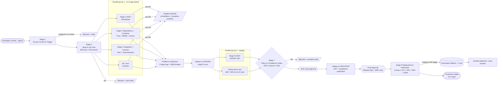

# Deliverable 1: Pipeline Architecture - NovaPay Digital Bank

**Author:** Manyashree U | **Related:** [Stage specs](stage-details/) | [Diagram source](diagrams/pipeline-flow.mmd)

## 1. Purpose and targets
NovaPay currently deploys by manual SSH every two weeks, has a 4.5 h MTTR, no automated compliance scanning, and 17 open RBI non-conformances. This pipeline replaces that with an automated, auditable path from commit to production.

| Metric | Today | Target | How the pipeline delivers it |
|--------|-------|--------|------------------------------|
| Deployment frequency | Every 2 weeks | Multiple per day | Trunk-based development, automated promotion |
| Commit-to-production | Days | < 2 hours | Parallel gates, compressed canary (section 5) |
| MTTR | 4.5 h | < 15 min | Automated rollback < 2 min, observability-driven detection |
| Availability | Unmeasured | 99.999% | Zero-downtime canary/blue-green, expand-contract migrations |
| RBI non-conformances | 17 | 0 | Compliance gates mapped to RBI/PCI-DSS, immutable audit trail |

## 2. Architecture diagram

Source: [pipeline-flow.mmd](diagrams/pipeline-flow.mmd). _Export a Draw.io/PNG version into [diagrams/](diagrams/) (required by the brief)._

## 3. The eight stages
| # | Stage | Tool | Key quality gate | Failure path | SLA | Detail |
|---|-------|------|------------------|--------------|-----|--------|
| 1 | Source control & trigger | GitHub Enterprise | Signed commits, PR review, no direct push | Block, notify author | <= 1 min | [spec](stage-details/stage-1-source-control.md) |
| 2 | Build & compilation | Gradle, Docker Buildx, JaCoCo | 100% unit tests, 80% line / 70% branch | Block, auto-ticket | <= 8 min | [spec](stage-details/stage-2-build.md) |
| 3 | Static analysis (SAST) | SonarQube | 0 Critical, <= 2 High, debt ratio <= 5% | Block, CISO exception 24 h | <= 5 min | [spec](stage-details/stage-3-sast.md) |
| 4 | Dependency & container scan | Trivy, SBOM, licence scan | 0 Critical CVE, no GPL/AGPL/SSPL | Block, 72 h remediation | <= 6 min | [spec](stage-details/stage-4-dependency-container-scan.md) |
| 5 | Integration & contract tests | Pact, Testcontainers, k6 | All contracts verified, no breaking API change | Block | <= 12 min | [spec](stage-details/stage-5-integration-contract-testing.md) |
| 6 | DAST | OWASP ZAP | 0 Critical/High (OWASP Top 10) | Block, risk acceptance + TRC | <= 12 min | [spec](stage-details/stage-6-dast.md) |
| 7 | Policy & compliance gates | OPA, Kyverno, Checkov, Cosign | All policies pass, image signed, SoD verified | Reject, exception workflow | <= 3 min | [spec](stage-details/stage-7-policy-compliance-gates.md) |
| 8 | Deployment & verification | ArgoCD, Argo Rollouts, Istio | Canary SLOs met, image hash consistent | Auto-rollback | <= 40 min | [spec](stage-details/stage-8-deployment-verification.md) |

Additional jobs inside these stages: commit-signature verification, licence scan, IaC scan (Checkov), SBOM generation, image signing and attestation, performance baseline.

## 4. Inputs and outputs per stage
| Stage | Inputs | Outputs |
|-------|--------|---------|
| 1 | Signed commit / PR | Verified SHA, run ID |
| 2 | SHA | Image tarball, coverage reports, SemVer version |
| 3 | Source + coverage XML | Quality gate result, SARIF |
| 4 | Image tarball, lock files | CVE report, SBOM, licence report |
| 5 | Image, migrations | Test and contract results, perf baseline |
| 6 | Staging URL, OpenAPI | ZAP report |
| 7 | Manifests, scan results, approvals | Signed image, attestations, JSON audit records |
| 8 | Signed digest, Helm values | Live release, verification report, DORA data |

## 5. Timing and parallelisation (estimated, p50)
| Step | Minutes | Cumulative | Notes |
|------|---------|-----------|-------|
| Stage 1 trigger + signature check | 1 | 1 | |
| Stage 2 build + unit tests + image | 6 | 7 | Cached |
| **Parallel group 1** (SAST 5, dependency 6, licence 3, IaC 3, integration 12) | 12 | 19 | Wall-clock = slowest job |
| Publish, sign, attest + deploy to staging | 4 | 23 | |
| **Parallel group 2** (DAST 12 || performance 10) | 12 | 35 | |
| Stage 7 policy gates | 3 | 38 | |
| Tech Lead approval (SLA) | 10 | 48 | Human |
| Pre-prod deploy + verification | 8 | 56 | |
| Dual approval RM + SRE Lead (SLA) | 10 | 66 | Human |
| Stage 8 standard canary | 40 | **106** | **~1 h 46 min < 2 h** |

For high-risk-tagged changes the full reference canary (15 + 30 + 60 = 105 min) applies, giving ~2 h 50 min; this is a deliberate trade-off, used only when risk justifies it. The 24 h bake happens after production is already at 100% and does not count toward lead time.

**Parallelisation:** about 78% of CI job-minutes (51 of 65) run inside parallel groups.
**Developer feedback loop (PR path):** trigger 1 + unit tests/lint 4 + SonarQube 3 (Trivy filesystem scan in parallel) is about 8 min, under the 10-minute target.

## 6. Deployment Velocity Audit - self-estimate
| Metric | Design value | Band | Points |
|--------|-------------|------|--------|
| Commit to production | ~1 h 46 min | < 2 h | 20 |
| Stage parallelisation | ~78% of CI minutes | > 50% | 20 |
| Developer feedback loop | ~8 min | < 10 min | 20 |
| Automated vs manual steps | ~92% (3 manual approvals out of ~40 steps) | > 90% | 14 |
| Rollback execution time | < 2 min (Istio weight revert) | < 2 min | 20 |

## 7. Branching, versioning and provenance
- **Trunk-based** with branches under 24 h; `hotfix/*` runs the same gates (expedited, never bypassed).
- **SemVer** `MAJOR.MINOR.PATCH+build.<sha7>.<timestamp>.<runid>`; Docker tags use `-` instead of `+`; `latest` is never deployed.
- **Chain of trust:** signed commit -> reviewed PR -> locked dependencies -> scanned image -> Cosign signature + SBOM attestation -> Kyverno admission check -> running pod.
- **Same artefact, different config:** one image is promoted through dev, staging, pre-prod and production; only Helm values change.

## 7a. Securing the pipeline itself
OIDC federation to AWS (no long-lived cloud keys); `permissions: contents: read` by default; third-party actions pinned to a version (pin to a commit SHA in production); separate deploy credentials from developer credentials (RBI 4.3); GitHub Environments with required reviewers for pre-prod and production; self-hosted runners in a private subnet for staging/production deploys.

## 8. Failure and rollback design
Every stage has a defined failure behaviour (table in section 3). Failures before production simply block promotion. In production, rollback is automatic for Category A and B triggers and independent of the deployment path (a traffic-weight revert in Istio), so a broken release cannot block its own rollback (Cloudflare lesson). Details in Deliverable 6.

## 9. Stakeholder lens
| Stakeholder | Concern | How addressed |
|-------------|---------|---------------|
| CTO | Velocity, ROI | Multiple deploys/day, < 2 h lead time |
| VP Engineering | Developer friction | ~8 min feedback loop, self-service |
| CISO | Threat model | SAST/DAST/SCA gates, signing, admission control |
| Head of Compliance | Audit evidence | JSON audit trail per gate, immutable change record |
| RBI auditor | Proof of controls | Gate-to-regulation mapping (Deliverable 3) |
| SRE team | On-call burden | Automated rollback, observability |

## 10. Assumptions
Cloud is AWS EKS (Kubernetes 1.29+); JFrog Artifactory is the registry; SonarQube runs as a managed or self-hosted server; staging is production-like but uses anonymised data.

## 11. Cross-references (completed on Day 13)
Deployment strategies -> [Deliverable 2](../02-deployment-strategies/) | Compliance gates -> [Deliverable 3](../03-compliance-gates/) | DB migration -> [Deliverable 4](../04-database-migration/) | Promotion -> [Deliverable 5](../05-environment-promotion/) | Rollback -> [Deliverable 6](../06-rollback-specification/) | Runbook -> [Deliverable 7](../07-runbook-playbook/) | Observability -> [Deliverable 8](../08-observability/)

> **AI Attribution:** Drafted with AI assistance (Claude, Anthropic). Author review: Manyashree U.
