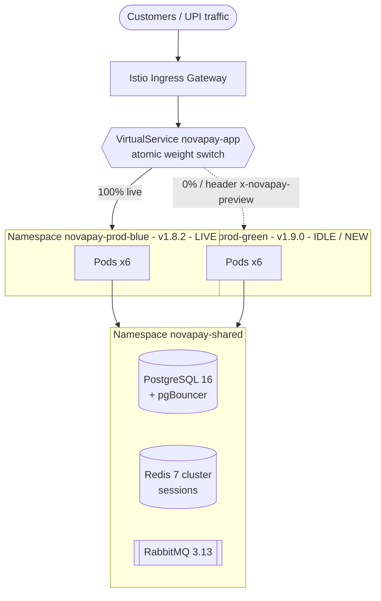
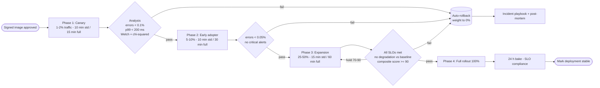

# Deliverable 2: Zero-Downtime Deployment Strategies - Blue-Green and Canary

**Author:** Manyashree U | **Implements:** [Pipeline Stage 8](../01-pipeline-architecture/stage-details/stage-8-deployment-verification.md) | **Rollback:** [Deliverable 6](../06-rollback-specification/) | **DB changes:** [Deliverable 4](../04-database-migration/migration-strategy.md)

## 1. When to use which strategy
| Situation | Strategy | Why |
|-----------|----------|-----|
| Stateless services, normal releases | **Canary** | Limits blast radius; real traffic validates the release |
| Payment-settlement, ledger or other releases that must switch all at once | **Blue-green** | Atomic cut-over, instant revert, full pre-switch verification |
| Releases containing a DB contract step | Blue-green plus a separate approved contract deployment | See Deliverable 4 |
| Config / routing / WAF rules | Canary by region or AZ through the same pipeline | Cloudflare lesson: no fleet-wide change at once |

Both strategies run on Kubernetes 1.29+ with Istio, and both are triggered by ArgoCD syncing a Git change, never by hand.

## 2. Blue-green

### 2.1 Topology

Source: [blue-green-topology.mmd](diagrams/blue-green-topology.mmd). Manifests: [istio-blue-green.yaml](manifests/istio-blue-green.yaml).

- Two identical environments in separate namespaces: `novapay-prod-blue` and `novapay-prod-green`. One is live, the other idle or receiving the new version.
- A shared `novapay-shared` namespace holds PostgreSQL (behind pgBouncer), the Redis cluster and RabbitMQ. Both colours use the same data layer.
- Traffic is switched by an atomic update to the Istio VirtualService weights (100/0 to 0/100). DNS and load-balancer changes are avoided because their propagation delay makes the switch non-atomic.

### 2.2 Traffic switching protocol (5 steps)
| Step | Action | Exit criterion | Automated? |
|------|--------|----------------|-----------|
| 1. Deploy | ArgoCD deploys the new version to the idle colour (6 pods) | All pods Ready, image digest identical on every pod | Yes |
| 2. Verify | Smoke tests and synthetic transactions through the `x-novapay-preview: true` route | 100% smoke pass; p99 < 200 ms; no error logs | Yes |
| 3. Pre-switch checks | DB schema compatible with both versions, Redis session round-trip, RabbitMQ consumers registered, no blackout window | All checks green | Yes |
| 4. Switch | VirtualService weights flipped to 100% on the new colour in a single commit | Weight change applied by Istio in seconds | Yes (dual-approved) |
| 5. Observe and drain | Old colour stops accepting new connections, finishes in-flight work, stays up for the rollback window | 30 min of SLO compliance, then the old colour is kept at minimum scale for 24 h | Yes |

**Rollback:** flip the weights back (a single Git revert). The old colour is still warm, so recovery takes seconds, well under the 2-minute target.

### 2.3 Banking-specific considerations
| Concern | Design |
|---------|--------|
| **Shared database** | Both colours read and write the same schema, so every schema change must be backward compatible (expand-contract, Deliverable 4). A contract (drop) step is never part of a blue-green switch. |
| **Session management** | Sessions live in the shared Redis cluster (3 nodes), not in pod memory, so users keep their session through the switch. Session payload format changes must be backward compatible for one release. |
| **Long-running transactions** | Payment-settlement jobs may run up to 5 minutes. The old colour gets a drain window (below); settlement workers stop pulling new RabbitMQ messages (prefetch set to 0), finish what they hold, and acknowledge. Operations carry idempotency keys so a retried request cannot be applied twice. |
| **Connection draining** | Old colour stops accepting new connections; in-flight HTTP requests may complete within **60 s** (30 s for typical API calls); settlement jobs get up to **5 min**. Implemented with a `preStop` sleep, `terminationGracePeriodSeconds` and Istio drain duration. |
| **Retries** | Istio retries only on `connect-failure` and `refused-stream`. Retrying a 5xx on a payment POST could double-charge, so it is disabled. |
| **Cost** | Two full environments are needed during the switch. The idle colour is scaled to minimum between releases to control cost. |

## 3. Canary

### 3.1 Four-phase progression

Source: [canary-progression.mmd](diagrams/canary-progression.mmd). Manifests: [argo-rollout-canary.yaml](manifests/argo-rollout-canary.yaml), [analysis-template.yaml](manifests/analysis-template.yaml).

| Phase | Traffic | Duration (full / standard) | Success criteria | Automatic action |
|-------|---------|----------------------------|------------------|------------------|
| 1. Canary | 1-2% | 15 min / 10 min | Error rate < 0.1%, p99 < 200 ms, statistical test passes | Proceed, or auto-rollback |
| 2. Early adopter | 5-10% | 30 min / 10 min | Error rate < 0.05%, no critical alerts | Proceed, or auto-rollback |
| 3. Expansion | 25-50% | 60 min / 15 min | All SLOs met, no degradation vs. baseline, composite score >= 90 | Proceed to full rollout, hold if 70-90, rollback if < 70 |
| 4. Full rollout | 100% | 24 h bake / 5 min | Complete SLO compliance | Mark deployment stable |

**Profiles.** The *standard* (compressed) profile reaches 100% in 40 minutes and is used for normal changes. It keeps NovaPay under the 2-hour commit-to-production target (about 1 h 46 min in total, see architecture section 5). The *full* profile (105 min plus a 24 h bake) is used for risk-tagged changes (payments core, authentication, ledger). The shorter profile still has enough statistical power because UPI-scale traffic produces thousands of requests per minute even at 2% weight. The 24-hour bake after reaching 100% is monitored, but does not delay the deployment record.

**Why the 2% starting weight is safe.** At 2%, a faulty release affects at most 2% of requests for at most 10 minutes. Category A rollback triggers (Deliverable 6) act within 60 seconds, so the realistic exposure is far lower.

## 4. Statistical analysis for promotion
Implemented in [canary_analysis.py](../../pipeline/scripts/canary_analysis.py) and run by the `statistical-comparison` metric in the Argo AnalysisTemplate.

| Question | Method | Detail |
|----------|--------|--------|
| Is canary **latency** worse than baseline? | **Welch's t-test** (one-sided) | Unequal variances and sample sizes; canary latency samples vs. the rolling baseline |
| Is the canary **error rate** worse? | **Chi-squared test** on a 2x2 table (errors/successes by baseline/canary) | Tests the difference in proportions, which suits rare events |
| Is canary **resource use** worse? | CPU and memory ratio canary/baseline | <= 1.10 pass, <= 1.25 warn, above that fail |

- **Confidence:** 95% (alpha = 0.05), divided by 3 (Bonferroni) because three metric families are tested per phase, so alpha per test is about 0.0167. This keeps false rollbacks low.
- **One-sided tests:** only a *worse* canary matters; a faster canary is not a failure.
- **Practical significance:** with large samples a tiny difference becomes statistically significant. A test only counts as a failure if the change is also meaningful (latency +10% or more, error rate +0.02 percentage points or more).
- **Baseline:** rolling 7-day production baseline from Prometheus (same hours of day and same weekday where possible), plus the concurrent stable ReplicaSet, which controls for traffic mix.
- **Minimum sample:** 100 latency samples and 100 requests per group, otherwise the verdict is "hold" (extend the phase).

**Composite score** (weighted across latency, errors and resources):

| Dimension | Weight | Score 100 | Score 50 | Score 0 |
|-----------|--------|-----------|----------|---------|
| Errors | 45% | Not worse | Significantly worse, but below the practical threshold | Significantly and meaningfully worse |
| Latency | 35% | Not worse | Significantly worse, but below the practical threshold | Significantly and meaningfully worse |
| Resources | 20% | Ratio <= 1.10 | Ratio <= 1.25 | Ratio > 1.25 |

Decision: **promote** at score >= 90, **hold** (stay in the phase for another interval) at 70-90, **roll back** below 70 or if latency or errors score 0 (a hard fail overrides the score).

Tested on synthetic data: a healthy canary scored 100 (promote), a canary with +33% latency and a higher error rate scored 20 (rollback), and a mildly slower canary with higher CPU scored 72.5 (hold).

## 5. Verification after every deployment
1. Every pod runs the same image digest ([verify-deployment.sh](../../pipeline/scripts/verify-deployment.sh)), the direct answer to the Knight Capital failure.
2. Smoke tests: health, login, balance enquiry, UPI collect in sandbox mode.
3. Synthetic transactions every minute from outside the cluster.
4. Kill-switch: any mismatch or failed check aborts the rollout and returns traffic to the stable version.

## 6. Comparison
| | Blue-green | Canary |
|---|-----------|--------|
| Rollback speed | Seconds (flip weights) | Seconds (weight to 0) |
| Blast radius | 0% until switch, then 100% | 2% then grows |
| Infrastructure cost | 2x during release | About 1.1-1.5x |
| Validation with real traffic | No (synthetic only) | Yes |
| Best for | Atomic, stateful or settlement changes | Most stateless releases |

## 7. Links to other deliverables
Pipeline stage detail: [Stage 8](../01-pipeline-architecture/stage-details/stage-8-deployment-verification.md) | Rollback triggers: [Deliverable 6](../06-rollback-specification/) | Metrics and dashboards: [Deliverable 8](../08-observability/) | DB compatibility: [Deliverable 4](../04-database-migration/migration-strategy.md)

> **AI Attribution:** Drafted with AI assistance (Claude, Anthropic). Author review: Manyashree U.
