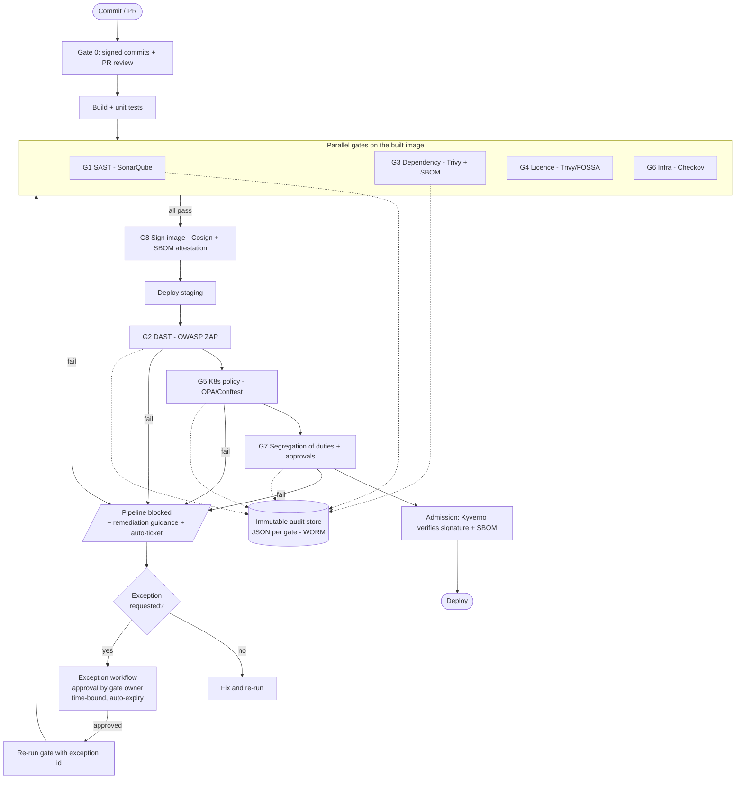

# Deliverable 3: Automated Compliance Gates

**Author:** Manyashree U | **Implements:** [Pipeline Stages 3-7](../01-pipeline-architecture/architecture.md) | **Policies:** [pipeline/policies](../../pipeline/policies/) | **Audit schema:** [audit-record.schema.json](audit-record.schema.json)

## 1. Overview
NovaPay's last RBI audit found 17 non-conformances, caused by manual, after-the-fact checks. Here every control is a **hard, automated, blocking gate**, each with (a) precise pass/fail thresholds, (b) remediation guidance, (c) a formal time-bound exception workflow, (d) a structured JSON audit record and (e) a mapping to specific regulatory requirements. The pipeline defines **8 gates**, G1 to G8, plus the signed-commit check G0 (the brief requires 6 or more).


Source: [gate-orchestration.mmd](diagrams/gate-orchestration.mmd)

## 2. Gate catalogue
| # | Gate | Tool | Pass threshold | On failure | Exception process (approver, validity) |
|---|------|------|----------------|------------|----------------------------------------|
| G1 | SAST | SonarQube | 0 Critical/Blocker, <= 2 High, line coverage >= 80%, new-code debt ratio <= 5% | Pipeline blocked, auto-ticket | CISO approval within 24 h; max 7 days |
| G2 | DAST | OWASP ZAP | 0 Critical / High from OWASP Top 10 (2021) | Pipeline blocked | Risk-acceptance form + Technology Risk Committee (TRC); max 14 days |
| G3 | Dependency (SCA) | Trivy + SBOM | 0 Critical CVE (CVSS >= 9.0); 0 High with CVSS > 8.0 and a fix available; SBOM generated | Pipeline blocked | 72 h remediation window, CISO approval; max 3 days |
| G4 | Licence | Trivy / FOSSA / ScanCode | No GPL / AGPL / SSPL dependencies | Legal review triggered | Legal team sign-off; max 30 days |
| G5 | Kubernetes policy | OPA/Conftest (pipeline) + Kyverno (admission) | All policies pass | Deployment rejected | Dual approval override (Release Manager + SRE Lead); max 7 days |
| G6 | Infrastructure | Checkov (Terraform, Helm) | No privileged containers, resource limits set, encryption enabled, no public storage | PR blocked | Tech Lead exemption; max 30 days |
| G7 | Segregation of duties | OPA (`compliance.sod`) | Author, approver and deployer are three different people; production needs Release Manager and SRE Lead | Promotion blocked | None (no exception; the control exists to prevent override) |
| G8 | Image provenance | Cosign + Kyverno `verifyImages` | Image signed by the CI identity, SBOM attestation attached, digest-pinned | Admission rejected | None (unsigned images never run) |

**Note on the dependency threshold.** The brief states the High-severity rule in two forms ("High = block if CVSS > 8.0" in the stage description, "blocked if CVSS >= 9.0" in the gate table). This design applies both together: Critical (>= 9.0) always blocks, and High findings above 8.0 block when a fixed version exists. The overlap is intentional, not a contradiction in this document.

## 3. Detailed gate specifications

### G1 - SAST (SonarQube)
| Severity | Threshold | Remediation guidance |
|----------|-----------|----------------------|
| Blocker / Critical | 0 | Fix before merge; the issue links to the rule and a compliant example |
| High | <= 2 | Fix or justify in review |
| Medium / Low | Reported; Medium ticketed with 30-day SLA | Backlog |
| Coverage (new code) | >= 80% line | Add unit tests; report names the uncovered classes |
| Technical debt ratio (new code) | <= 5% | Refactor the flagged hotspots |
Custom banking rules: no PII in logs, no weak crypto, no string-built SQL, no hard-coded secrets (see [Stage 3](../01-pipeline-architecture/stage-details/stage-3-sast.md)).

### G2 - DAST (OWASP ZAP)
0 Critical or High findings mapped to the OWASP Top 10. Medium findings become tickets (30-day SLA). Remediation text links to the matching OWASP cheat sheet. False positives are suppressed only through a rule file entry that has a justification, an owner and a 30-day expiry.

### G3 - Dependency scan (Trivy)
| Finding | Rule |
|---------|------|
| Critical (CVSS >= 9.0) | Block |
| High with CVSS > 8.0 and a fix available | Block |
| High without a fix | Report + exception request path |
| Medium / Low | Report |
| SBOM (CycloneDX 1.5) | Required, attached to the image as a Cosign attestation, archived 7 years |
Remediation: the report names the fixed version; Dependabot/Renovate opens the upgrade PR automatically.

### G4 - Licence
Denied: GPL-2.0/3.0, AGPL-3.0, SSPL. Allowed: MIT, Apache-2.0, BSD-2/3, ISC. Unknown licence goes to legal review. Rationale: copyleft obligations can force disclosure of proprietary banking code.

### G5 - Kubernetes policy (OPA/Rego + Kyverno)
Seven Conftest policies in [k8s-security.rego](../../pipeline/policies/k8s-security.rego) and [transport-security.rego](../../pipeline/policies/transport-security.rego):

| ID | Policy | Regulatory link |
|----|--------|-----------------|
| P1 | No privileged containers | PCI-DSS 6.5, RBI 4.2 |
| P2 | CPU and memory limits required | RBI 6.3 (availability) |
| P3 | Must run as non-root | PCI-DSS 6.5 |
| P4 | No privilege escalation | PCI-DSS 6.5 |
| P5 | Images only from the approved registry | RBI 7.2 |
| P6 | No `latest`/untagged images | RBI 4.2 (traceability) |
| P7 | TLS 1.3 on every Istio Gateway; HTTP must redirect | RBI 5.4 |

Kyverno re-enforces the signature, SBOM, privileged and `latest` checks inside the cluster ([verify-signed-images.yaml](../../pipeline/policies/kyverno/verify-signed-images.yaml), [restrict-privileged-and-latest.yaml](../../pipeline/policies/kyverno/restrict-privileged-and-latest.yaml)), so a manual `kubectl apply` cannot bypass the pipeline.

### G6 - Infrastructure (Checkov)
Scans Terraform and Helm for: encryption at rest disabled, public buckets, security groups open to 0.0.0.0/0, missing resource limits. Failure blocks the PR; the Tech Lead may grant a time-bound exemption.

### G7 - Segregation of duties
Policy [segregation-of-duties.rego](../../pipeline/policies/segregation-of-duties.rego): author != approver != deployer; production changes need both a Release Manager and an SRE Lead. Deploy credentials are held by a separate service identity that developers cannot use (RBI 4.3).

### G8 - Image provenance
Image signed with Cosign (keyless, OIDC identity of the CI workflow), SBOM attested, digest pinned. Kyverno rejects anything else at admission.

## 4. Formal exception workflow
1. **Request:** the developer opens a PR adding an exception file using [exception-template.yaml](exceptions/exception-template.yaml) (finding, justification, compensating controls, requested expiry).
2. **Approval:** the gate's approver(s) (table above) approve in the PR. CODEOWNERS prevents anyone else from approving.
3. **Validation:** [exception-governance.rego](../../pipeline/policies/exception-governance.rego) checks that the approver roles are correct, the validity does not exceed the gate's maximum, and the exception has not expired.
4. **Application:** the gate re-runs with the exception id; the result is `pass_with_exception` in the audit record, and a remediation ticket is mandatory.
5. **Auto-expiry:** after `expires_at` the policy fails and the gate applies again, with no manual cleanup needed. Expiring exceptions are listed weekly to the CISO and Head of Compliance.
6. **Review:** all exceptions are reviewed monthly; repeat exceptions for the same finding trigger a TRC review.

## 5. Structured audit trail
Every gate writes one JSON record per execution to an append-only store (S3 Object Lock in compliance mode, 7-year retention). Schema: [audit-record.schema.json](audit-record.schema.json); example: [sample-audit-record.json](sample-audit-record.json). Fields: gate, run id, commit SHA, image digest, environment, actors (author, approvers, deployer), result, thresholds, findings summary, exception id, remediation ticket, regulatory references, timestamp. The records, joined by commit SHA, give the auditor one complete chain from commit to production.

## 6. Regulatory mapping
Section numbers follow the project brief (A.4.1 and A.4.2); verify them against the source texts before the TRC presentation.

| Regulation | Requirement | Gate(s) |
|------------|-------------|---------|
| RBI 4.2 | Change management: testing, approval, rollback | G1-G8, Deliverable 6 |
| RBI 4.3 | Segregation of duties | G7 |
| RBI 5.1 | Regular vulnerability assessment | G1, G2, G3 |
| RBI 5.4 | Encryption in transit and at rest | G5 (P7), G6 |
| RBI 6.1 | Comprehensive audit trails | Audit record (all gates) |
| RBI 6.3 | Incident management and continuity | G5 (P2), Deliverables 6 and 7 |
| RBI 7.2 | Third-party risk | G3, G4, G8 |
| PCI-DSS 6.2 | Bespoke software security | G1 + mandatory peer review |
| PCI-DSS 6.3 | Security vulnerabilities | G3 |
| PCI-DSS 6.4 | Public-facing web app protection | G2 + WAF integration |
| PCI-DSS 6.5 | Change management | G5, G7, Deliverable 5 |
| PCI-DSS 10.2 | Audit log recording | Audit record |
| PCI-DSS 11.3 / 11.4 | Vulnerability scans / penetration testing | G2 plus scheduled external pen test |
| PCI-DSS 12.6 | Security awareness training | Training-verification check at promotion (Deliverable 5) |

> **Check this against the standard:** the brief lists "11.3 Penetration Testing". As far as I know, PCI DSS v4.0 places penetration testing under requirement 11.4 and uses 11.3 for vulnerability scans. This document cites both; confirm in the standard. It may be one of the deliberate errors (ERRATA.md).

## 7. Testing the gates
Unit tests: [policy_test.rego](../../pipeline/policies/policy_test.rego). Fixtures: [good-deployment.yaml](../../pipeline/policies/fixtures/good-deployment.yaml) passes; [bad-deployment.yaml](../../pipeline/policies/fixtures/bad-deployment.yaml) violates five policies. Commands (needs OPA and Conftest installed):
```
opa test pipeline/policies -v
conftest test pipeline/policies/fixtures/good-deployment.yaml -p pipeline/policies    # expect pass
conftest test pipeline/policies/fixtures/bad-deployment.yaml  -p pipeline/policies    # expect failures
```
Save the output in `evidence/test-results/`. The policies have not been executed in the environment where they were written; run them and fix any syntax issues before committing the results.

## 8. Links
[Pipeline stages](../01-pipeline-architecture/architecture.md) | [Environment promotion](../05-environment-promotion/environment-promotion.md) | [Rollback](../06-rollback-specification/) | [Observability](../08-observability/)

> **AI Attribution:** Drafted with AI assistance (Claude, Anthropic). Author review: Manyashree U.
