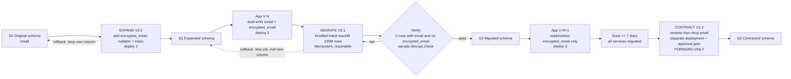

# Deliverable 4: Zero-Downtime Database Migration Strategy

**Author:** Manyashree U | **Database:** PostgreSQL 16 behind pgBouncer | **Pattern:** expand-contract | **Related:** [Deployment strategies](../02-deployment-strategies/deployment-strategies.md), [Rollback](../06-rollback-specification/)

## 1. Scenario and scope
The Database Migration Challenge asks for a zero-downtime migration of a table with **100M+ rows of financial data**, with no maintenance window. NovaPay currently migrates manually at 2 AM. The worked example follows the brief's reference: `customer_profiles.email` (plaintext) must become an encrypted column, `encrypted_email`, on a table of about 100 million rows. The same method applies to type changes and column splits on tables such as `transactions`.

Scripts: [examples/](examples/) | Phase diagram: [expand-contract-phases.mmd](diagrams/expand-contract-phases.mmd)

## 2. Expand-contract in three phases

| Phase | What happens | Script | Reversible? | Own deployment and gate? |
|-------|--------------|--------|-------------|--------------------------|
| **EXPAND** | Add `encrypted_email` and `email_hash` (nullable, no default) and a concurrent index. Old app ignores them. | [V2.0](examples/V2.0__expand_add_encrypted_email.sql) | Yes: drop the new objects | Yes |
| **MIGRATE** | App V(N) dual-writes both columns; a throttled job backfills existing rows. | [V2.1](examples/V2.1__migrate_backfill_encrypted_email.sql) | Yes: stop the job, null the new column | Yes |
| **CONTRACT** | After all services read only the new column, rename then drop `email`. | [V2.2](examples/V2.2__contract_drop_email.sql.manual) | **No** after the drop (rename step is reversible) | Yes: separate release with its own approval |

Each phase is independently deployable and reversible, except the final drop, which is forward-only and therefore never bundled with other changes.

## 3. Version compatibility matrix
App versions: **V(N-1)** = reads/writes `email` only (current production); **V(N)** = dual-writes, reads new column with fallback to `email`; **V(N+1)** = reads/writes `encrypted_email` only.
Schema states: **S0** original; **S1** expanded; **S2** expanded and fully backfilled; **S3** contracted.

| App \ Schema | S0 original | S1 expanded | S2 migrated | S3 contracted |
|--------------|:-----------:|:-----------:|:-----------:|:-------------:|
| **V(N-1)** | OK | OK (ignores new columns) | OK (email still present) | **FAIL** (email gone) |
| **V(N)** | **FAIL** (columns missing) | OK (falls back to email) | OK | OK |
| **V(N+1)** | **FAIL** | **FAIL** (rows not yet backfilled) | OK | OK |

**Rules that follow from the matrix**
1. Expand (S0 to S1) before deploying V(N): the schema is always ahead of the app.
2. Both V(N-1) and V(N) must run together during the rolling or canary deployment: only S1 and S2 satisfy both.
3. Deploy V(N+1) only after verification proves S2 (zero un-migrated rows).
4. Contract (S3) only when no V(N-1) or V(N) instance remains, anywhere (including batch jobs and reporting).

## 4. Execution guide (step by step)
| # | Step | Gate / check | Owner |
|---|------|--------------|-------|
| 1 | Rehearse the full sequence on **pre-prod with production-scale data (100M rows)**; record duration, lock waits and latency impact | Rehearsal report attached to the change | DBA + SRE |
| 2 | DBA review using the checklist (section 6); CAB or pre-approved change category | Approval recorded | DBA |
| 3 | Check deployment window: not in a blackout day or peak hours | `check-deploy-window.sh` passes | Pipeline |
| 4 | Run V2.0 (EXPAND) via Flyway; verify new objects exist and p95 latency unchanged | Latency within +5% | Pipeline |
| 5 | Deploy app V(N) (dual-write) through the canary pipeline | Canary passes | Pipeline |
| 6 | Start V2.1 backfill job with guards on (section 5) | Guard alerts silent | DBA |
| 7 | Verify: 0 rows with `email` but no `encrypted_email`; sampled decrypt equals original | Both checks = 0 | DBA |
| 8 | Deploy app V(N+1) via canary | Canary passes | Pipeline |
| 9 | Soak at least 7 days; confirm no queries read the old column (`pg_stat_statements`) | Zero references | DBA |
| 10 | **Separate release:** run V2.2 contract (rename, observe, drop) | DBA + Tech Lead + CAB, fresh backup | DBA |

## 5. Backfill strategy for 100M+ rows
| Parameter | Value | Reason |
|-----------|-------|--------|
| Batch size | 5,000 rows (tune 1,000-10,000 in rehearsal) | Short transactions, small lock footprint |
| Batching key | Primary-key range (`id > last AND id <= last + batch`) | Index range scan; avoids repeated `IS NULL` scans that slow down as the job progresses |
| Commit per batch | Yes (stored procedure with `COMMIT`) | A `DO` block is one transaction: locks held to the end, WAL bloat, throttling useless |
| Throttle | 50 ms sleep; runner raises it to 200 ms when guards approach limits | Protect production queries and replicas |
| Idempotency | `WHERE encrypted_email IS NULL` | Safe to re-run any number of times |
| Resumability | Checkpoint `last_id` logged every batch; `p_from_id` restarts from it | An abort loses at most one batch |
| Concurrency | One worker (a few workers on disjoint id ranges only if the rehearsal shows headroom) | Keep replication lag controlled |
| Expected duration | Estimated 3-6 hours for 100M rows (about 5-10k rows/s with encryption); confirm in rehearsal | Plan the run in an off-peak window outside blackout dates |
| Bloat | Each updated row creates a new tuple version (table about doubles until vacuum). Raise autovacuum aggressiveness on the table during the job and run `VACUUM (ANALYZE)` after | Prevent bloat and stale statistics |

**Automatic abort criteria** ([migration-guard-alerts.yaml](examples/migration-guard-alerts.yaml))
- **Query latency more than 20% above baseline for 2 min: abort automatically and alert the DBA** (requirement from the brief).
- Replication lag above 5 s: pause and raise the throttle.
- More than 10 sessions waiting on locks: pause.
- WAL or disk free below 20%: abort.

## 6. Migration governance framework
**Approval gate:** DBA approval is mandatory for every production migration. The CONTRACT phase additionally needs Tech Lead and CAB approval (segregation of duties: the author of the migration cannot approve it, RBI 4.3).

**DBA review checklist**
- [ ] Change is backward compatible with the currently deployed app version (matrix checked)
- [ ] `lock_timeout` and `statement_timeout` set; no statement takes an `ACCESS EXCLUSIVE` lock for more than a moment
- [ ] No table rewrite (nullable column, no volatile default; constraints added `NOT VALID` then `VALIDATE` separately)
- [ ] Indexes created `CONCURRENTLY` and the migration runs outside a transaction (Flyway `executeInTransaction=false`)
- [ ] Backfill is batched, idempotent, resumable, throttled
- [ ] Rehearsed on production-scale data with measured impact
- [ ] Rollback script exists for the phase ([rollback.sql](examples/rollback.sql))
- [ ] Backup and point-in-time recovery window confirmed before CONTRACT
- [ ] Audit row written to `schema_audit_log`
- [ ] Deployment window verified

**Audit trail:** each phase writes to `schema_audit_log` (migration id, description, executor, phase), and the pipeline attaches the Flyway output to the immutable change record (RBI 6.1, PCI-DSS 10.2).

## 7. Tool selection
| Tool | Role | Decision |
|------|------|----------|
| **Flyway** | Versioned, auditable migration scripts in Git (`V2.0`, `V2.1`, ...) | **Used** for sequencing and audit |
| **Native PostgreSQL online techniques** | `ADD COLUMN` nullable, `CREATE INDEX CONCURRENTLY`, `NOT VALID` constraints, batched backfill | **Used** for most changes |
| **pgroll** | Expand-contract automation for PostgreSQL with versioned schemas; useful for column type changes | **Recommended** for complex type changes (configure in rehearsal first) |
| pg_repack | Reclaim bloat after the backfill without a long lock | Used after backfill if bloat exceeds a threshold |
| gh-ost / pt-online-schema-change | Online schema change tools for **MySQL** | **Not applicable**: NovaPay runs PostgreSQL 16 |

## 8. Improvements over the brief's reference scripts
The appendix scripts are a starting point. This deliverable changes the following, and explains why:
1. **Backfill in a single `DO` block** runs as one transaction. It is replaced by a procedure that commits per batch.
2. **`CREATE INDEX CONCURRENTLY`** fails inside a transaction, and Flyway wraps scripts in one by default. The `.conf` file disables that.
3. **An index on `encrypted_email`** cannot serve lookups, because `pgp_sym_encrypt` is non-deterministic. A blind index column (`email_hash`, an HMAC) is used instead.
4. **`ALTER TABLE` without `lock_timeout`** can queue behind a long query and block all traffic behind it. `lock_timeout` makes it fail fast and retry.
5. **The encryption key in SQL** (`current_setting`) can leak into logs. The runner takes it from Vault, with app-side or KMS encryption preferred.
6. **A hard `DROP COLUMN`** is replaced by rename-then-drop (soft contract), so the last chance to reverse is cheap.
7. **Batching** uses primary-key ranges instead of repeated `IS NULL` scans.

> The SQL has not been executed against a PostgreSQL instance in this environment. Run the rehearsal (step 1) on a copy of the schema, for example on a local PostgreSQL 16 container, and keep the output in `evidence/test-results/`.

## 9. Links
[Pipeline architecture](../01-pipeline-architecture/architecture.md) | [Deployment strategies](../02-deployment-strategies/deployment-strategies.md) | [Environment promotion](../05-environment-promotion/) (pre-prod rehearsal data) | [Rollback](../06-rollback-specification/) | [Runbook](../07-runbook-playbook/)

> **AI Attribution:** Drafted with AI assistance (Claude, Anthropic). Author review: Manyashree U.
