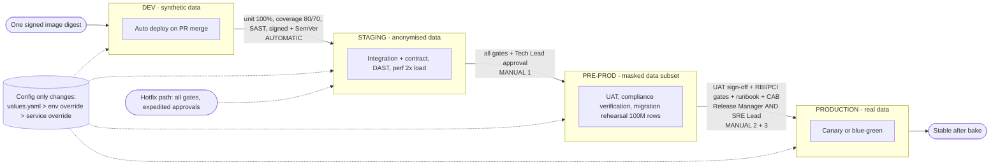

# Deliverable 5: Four-Environment Promotion Workflow

**Author:** Manyashree U | **Related:** [Pipeline architecture](../01-pipeline-architecture/architecture.md), [Compliance gates](../03-compliance-gates/compliance-gates.md), [Database migration](../04-database-migration/migration-strategy.md) | **Config:** [pipeline/helm/novapay](../../pipeline/helm/novapay/)

## 1. Principle: same artefact, different configuration
One container image, identified by its **digest**, is promoted through all four environments. Only configuration changes. No environment-specific branches exist: `main` produces the same image for every environment, and differences live **only in configuration, never in code**. [check-same-artifact.sh](../../pipeline/scripts/check-same-artifact.sh) fails the promotion if two environments reference different digests (tested on sample data).


Source: [promotion-flow.mmd](diagrams/promotion-flow.mmd)

## 2. The four environments
| Environment | Purpose | Data profile | Access control | Deploy trigger |
|-------------|---------|--------------|----------------|----------------|
| **Development** | Feature development, unit testing | Synthetic / mock data only | All developers | Automatic on PR merge |
| **Staging** | Integration testing, DAST, performance | Anonymised production-like data | Dev team + QA | Automatic after dev gates pass |
| **Pre-Production** | UAT, compliance verification, regulatory checks, migration rehearsal | Masked production data subset | QA + Compliance + DBA | Manual approval after staging |
| **Production** | Live customer-facing service | Real production data | SRE + Release Manager only | Dual approval (Release Manager + SRE Lead) |

## 3. Promotion criteria

### Dev to Staging (automatic, no human approval if every gate passes)
- All unit tests pass (100%, zero tolerated failures)
- Line coverage >= 80%, branch coverage >= 70%
- SAST: 0 Critical, <= 2 High
- Image built, signed and pushed with its SemVer tag

### Staging to Pre-Prod (manual: Tech Lead)
- All integration tests pass, including consumer-driven contract tests
- DAST complete with 0 Critical/High findings (OWASP Top 10)
- Performance test: p99 < 500 ms at 2x expected production load
- Dependency scan: 0 Critical CVEs, SBOM generated and archived
- Licence check passed (no GPL/AGPL)
- **Tech Lead approval** (GitHub Environment `pre-prod`, self-review disabled)

### Pre-Prod to Production (manual: dual approval)
- UAT sign-off from the **Product Owner** (formal written approval)
- All regulatory compliance gates passed (RBI + PCI-DSS mapping verified, [Deliverable 3](../03-compliance-gates/compliance-gates.md))
- Database migration tested and validated in pre-prod with production-scale data ([Deliverable 4](../04-database-migration/migration-strategy.md))
- Deployment runbook reviewed, updated and signed off by the **SRE Lead**
- **Change Advisory Board (CAB) approval, or a pre-approved change category** (section 4)
- **Dual approval: Release Manager AND SRE Lead** (segregation of duties; the author can approve neither)
- Deployment-window verification: not in a blackout period and not in peak hours ([check-deploy-window.sh](../../pipeline/scripts/check-deploy-window.sh))
- On-call engineer confirmed available and briefed
- Security-awareness training verification for the approvers and deployer (PCI-DSS 12.6)

## 4. Approval workflows and RBAC

### Named roles
| Role | Responsibility in promotion |
|------|-----------------------------|
| Developer | Authors changes; no approval rights on their own change |
| QA Engineer | Owns staging/pre-prod test sign-off |
| Tech Lead | Approves staging to pre-prod |
| DBA | Approves migrations; access to pre-prod/production databases |
| Compliance Officer | Reviews the evidence pack (gate audit records) for non-pre-approved changes |
| Product Owner | Written UAT sign-off |
| SRE Lead | Production approver; signs off the runbook |
| Release Manager | Production approver; owns the deployment window |
| CISO | Exceptions on SAST/dependency gates; notified of hotfixes |

### Approval workflow
| Transition | Mechanism | Approvers | Target SLA |
|------------|-----------|-----------|-----------|
| Dev to Staging | Pipeline | None (automatic) | 0 min |
| Staging to Pre-Prod | GitHub Environment `pre-prod` required reviewer | Tech Lead | 10 min |
| Pre-Prod to Production | GitHub Environment `production` required reviewers (self-review prevented) | Release Manager + SRE Lead (+ CAB unless pre-approved) | 10 min |
| Production exceptions | Exception PR ([Deliverable 3](../03-compliance-gates/compliance-gates.md)) | Per gate | Per gate |

**Pre-approved change categories** (reviewed yearly by the CAB, so routine low-risk changes do not wait for a meeting): configuration-only changes, dependency patch updates that pass all gates, and feature-flag percentage increases within agreed limits. They still need the dual approval; only the CAB meeting is skipped.

**Emergency / hotfix path:** the hotfix runs **all** security and compliance gates (expedited, never bypassed). The change goes through the compressed canary profile with Release Manager + SRE Lead approval, the CISO is notified, UAT is replaced by a recorded Product Owner confirmation within 1 hour, and an emergency CAB ratifies the change within 24 hours.

### RBAC matrix
| Role | Dev | Staging | Pre-Prod | Production |
|------|-----|---------|----------|------------|
| Developer | read/write | read/write | no access | no access (read-only dashboards) |
| QA Engineer | read | read/write | read/write | no access |
| DBA | read | read | read/write (DB) | DB admin (change-gated) |
| Compliance Officer | no access | read | read | read-only (audit views) |
| Tech Lead | admin | admin | approve | read-only |
| SRE Lead | read | read | read | approve + admin |
| Release Manager | no access | no access | read | approve + deploy |
| Deploy bot (service identity) | deploy | deploy | deploy | deploy (separate credentials, RBI 4.3) |

Implementation: Kubernetes RBAC with one namespace group per environment, ArgoCD AppProjects with per-environment roles, GitHub Environments with required reviewers, and SSO groups mapped to roles. No human holds standing production write access; break-glass access is time-boxed, approved by the Release Manager and SRE Lead, and logged.

## 5. Configuration management

### Hierarchy (three layers)
```
values.yaml                  base: shared by all environments
 └─ values-<env>.yaml        environment override: dev | staging | preprod | production
     └─ services/<svc>.yaml  service override: per-service customisation (e.g. payments drain window)
```
Files: [values.yaml](../../pipeline/helm/novapay/values.yaml), [values-dev.yaml](../../pipeline/helm/novapay/values-dev.yaml), [values-staging.yaml](../../pipeline/helm/novapay/values-staging.yaml), [values-preprod.yaml](../../pipeline/helm/novapay/values-preprod.yaml), [values-production.yaml](../../pipeline/helm/novapay/values-production.yaml), [services/payments.yaml](../../pipeline/helm/novapay/services/payments.yaml). Rendered with later files overriding earlier ones:
```
helm template novapay pipeline/helm/novapay -f values.yaml -f values-production.yaml -f services/payments.yaml
```

### Secrets
HashiCorp Vault or AWS Secrets Manager with automatic rotation: **90 days** for database passwords, **30 days** for API keys. Secrets never appear in Git, Helm values or Kubernetes manifests: values files hold only references, and the External Secrets Operator syncs them into the cluster. Each environment has its own secret path and its own credentials; production secrets are readable only by the production workload identity.

### Feature flags
Environment-aware toggles. New features **deploy to every environment but stay off in production** until ready (deploy is separated from release). Gradual rollout by flag percentage **1% to 10% to 50% to 100%** mirrors the canary pattern, and every flag has an instant kill switch. Flag changes are config-as-code and go through the same pipeline and audit trail. Flags are removed within 30 days of reaching 100%, to avoid dead code (the Knight Capital lesson).

### Configuration drift detection
ArgoCD compares the Git-declared state with the live cluster **every 3 minutes** (`timeout.reconciliation: 180s`). Any drift triggers a Slack notification (`on-out-of-sync`) and an incident ticket. Policy per environment:

| Environment | Auto-sync / self-heal | Reason |
|-------------|----------------------|--------|
| Dev, Staging | On | Fast feedback, low risk |
| Pre-Prod | On, with alert | Must stay identical to the planned production state |
| Production | Self-heal on, plus alert and ticket | A manual change is treated as a potential unauthorised change (RBI 4.3) and is reverted; break-glass pauses sync for at most 2 hours with dual approval |

## 6. Data management per environment
| Environment | Profile | How it is produced | Refresh |
|-------------|---------|--------------------|---------|
| Dev | Synthetic | Seeded generators (fake names, accounts, transactions); no real person's data | On demand |
| Staging | Anonymised | Production extract passed through an irreversible anonymisation job (hashing, generalisation, shuffling); cannot be linked back | Weekly |
| Pre-Prod | Masked subset | Production subset with format-preserving masking/tokenisation (account and card numbers, PII); keeps referential integrity so migrations behave realistically | Before each major release and for migration rehearsals |
| Production | Real | Live data | n/a |

Rules: data flows **only downward through the masking pipeline**, run by the DBA with Compliance sign-off in an isolated environment; real card numbers (PANs) never leave the cardholder data environment (PCI-DSS); non-production environments have no outbound path to live payment gateways (`paymentGateway: sandbox`); data-masking job outputs are logged for audit.

## 7. How this satisfies the regulators
| Requirement | Control |
|-------------|---------|
| RBI 4.2 change management | Gated promotion, dual approval, rollback ([Deliverable 6](../06-rollback-specification/)) |
| RBI 4.3 segregation of duties | RBAC matrix, separate deploy credentials, SoD gate |
| PCI-DSS 6.5 change management | Environment promotion workflow with documented approvals |
| PCI-DSS 12.6 training | Training-verification check at promotion |
| RBI 6.1 audit trail | Each promotion writes gate audit records ([schema](../03-compliance-gates/audit-record.schema.json)) |

## 8. Links
[Architecture](../01-pipeline-architecture/architecture.md) | [Deployment strategies](../02-deployment-strategies/deployment-strategies.md) | [Runbook](../07-runbook-playbook/) | [Observability](../08-observability/)

> **AI Attribution:** Drafted with AI assistance (Claude, Anthropic). Author review: Manyashree U.
