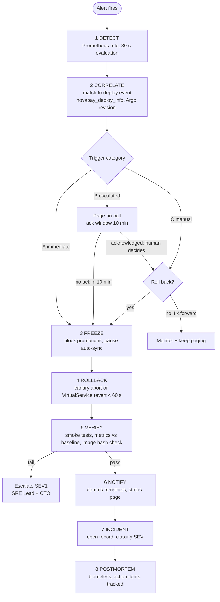

# Deliverable 6: Automated Rollback Specification

**Author:** Manyashree U | **Rules:** [rollback-rules.yaml](alerts/rollback-rules.yaml) | **Script:** [emergency-rollback.sh](../../pipeline/scripts/emergency-rollback.sh) | **Related:** [Deployment strategies](../02-deployment-strategies/deployment-strategies.md), [Observability](../08-observability/observability.md), [Incident playbook](../../runbooks/incident-playbook.md)

## 1. Design principles
1. **Automation is the safety net that makes rapid deployment possible.** NovaPay's 4.5 h MTTR becomes under 15 min only if the first response needs no human.
2. **Rollback is independent of the deployment path.** Cloudflare's 2019 outage lasted 27 minutes partly because the deployment system was itself affected. Here rollback runs inside the cluster (Argo Rollouts analysis and Istio weights) and has a break-glass script that needs only `kubectl`, not CI, the registry or GitHub.
3. **Rollback never needs a schema rollback.** Expand-contract migrations ([Deliverable 4](../04-database-migration/migration-strategy.md)) keep both app versions compatible with the schema.
4. **Rollback must not fight GitOps.** ArgoCD self-heal would re-apply the bad version from Git, so the *freeze* step pauses auto-sync first and a Git revert follows.
5. **Timing definition.** "Immediate (< 60 s)" in the brief is measured from the *trigger firing* to *traffic restored to the stable version*. Fault onset to restored traffic is therefore about 2 minutes, consistent with the < 2 min rollback figure in [Deliverable 1](../01-pipeline-architecture/architecture.md).

## 2. Trigger taxonomy
Machine-readable definitions: [rollback-rules.yaml](alerts/rollback-rules.yaml).

### Category A - Immediate (< 60 s), fully automatic, zero human intervention
| # | Trigger | Detection method | Threshold | Action |
|---|---------|------------------|-----------|--------|
| A1 | HTTP 5xx rate | Istio `istio_requests_total`, 1-min ratio | > 5% for 60 s | Instant traffic re-route to stable |
| A2 | Health-check failure | Blackbox probe every 10 s | 3 consecutive failures | Instant re-route |
| A3 | OOM kills | kube-state-metrics: restarts + last terminated reason | Any OOMKilled in production during a rollout | Instant re-route |
| A4 | CrashLoopBackOff | kube-state-metrics waiting reason | Present for 30 s | Instant re-route |
| A5 | DB connection pool exhaustion | HikariCP pending connections | > 10 pending for 30 s | Instant re-route |

### Category B - Escalated (< 15 min), page first, then automatic
| # | Trigger | Detection / alerting | Threshold | Escalation |
|---|---------|----------------------|-----------|------------|
| B1 | Latency regression | p99 from Istio histogram vs 7-day baseline recording rule | p99 > 2x baseline for 5 min | Page on-call (SEV-2) |
| B2 | Error-budget burn | Multi-window burn rate on SLO 99.99% request success (budget 0.01%) | Burn > 10x on 5 min and 30 min windows | Page on-call |
| B3 | Transaction success drop | Business metric `novapay_payment_success_ratio` vs baseline | More than 2 percentage points below baseline for 3 min | Page on-call |
| B4 | Resource saturation | cAdvisor CPU and memory vs limits | CPU > 90% or memory > 85%, sustained 5 min | Page on-call |

**Escalation flow:** page the on-call engineer; they have a **10-minute acknowledgement window** (leaving 5 minutes of the 15-minute budget for execution). If acknowledged, the engineer decides (roll back, or fix forward with a flag or scale-up). If there is no acknowledgement, the rollback controller triggers the automatic rollback and escalates to the SRE Lead.

### Category C - Manual decision
| Trigger | Why it is not automatic |
|---------|------------------------|
| Gradual degradation below Category B thresholds (p99 > 1.3x baseline for 30 min) | Needs judgement: normal load growth or a regression? |
| Customer-support reports of failures not visible in metrics | Metrics cannot see them yet |
| Retroactive compliance failure (a gate result invalidated after release) | Rollback may increase risk; Compliance decides |
| Downstream dependency correlation (payment gateway failures after a release) | Could be the gateway's fault, so rolling back would not help |

Category C alerts warn only (`action: notify_only`) and surface in the incident channel.

## 3. Eight-step rollback execution workflow

Source: [rollback-workflow.mmd](diagrams/rollback-workflow.mmd)

| # | Step | What happens | Owner | Time budget |
|---|------|--------------|-------|-------------|
| 1 | **Detect** | Prometheus rule fires (30 s evaluation) | Automation | <= 30 s |
| 2 | **Correlate** | Alert is matched to the latest deployment event (`novapay_deploy_info`, Argo revision, change record) to confirm the release is the likely cause; if no release in the last 2 h, treat as a non-deployment incident (no rollback) | Automation | <= 30 s |
| 3 | **Freeze** | Block further promotions (`deploy-freeze` ConfigMap, pipeline reads it), pause ArgoCD auto-sync | Automation | <= 5 s |
| 4 | **Rollback** | Canary: `argo rollouts abort` (weight to 0) or `undo` if fully promoted. Blue-green: VirtualService weights flipped back. Feature-flag kill switch where the change is flag-gated | Automation / on-call | <= 60 s |
| 5 | **Verify** | Post-rollback verification (section 4) | Automation + on-call | <= 5 min |
| 6 | **Notify** | Communication templates ([playbook](../../runbooks/incident-playbook.md)), status page | Comms lead | <= 5 min |
| 7 | **Incident** | Open the incident record, classify severity (SEV-1 to SEV-4), assign Incident Commander | On-call | <= 5 min |
| 8 | **Postmortem** | Blameless review; action items tracked to closure; Git revert merged so Git matches reality; auto-sync re-enabled | Incident Commander | Within 5 working days (SEV-1: draft in 48 h) |

**Three execution paths (for resilience):**
1. *Primary:* Argo Rollouts analysis aborts automatically in-cluster (no CI involved).
2. *Alertmanager webhook:* the rollback controller acts on `action=auto_rollback` alerts.
3. *Break-glass:* `emergency-rollback.sh canary|bluegreen "reason"` run by the on-call with out-of-band credentials. It freezes, rolls back and verifies. Its syntax is checked, but it has not been run against a real cluster, so rehearse it in staging.

## 4. Post-rollback verification
| Check | Method | Pass condition |
|-------|--------|----------------|
| Smoke tests | Health, login, balance enquiry, UPI collect (sandbox) | 100% pass |
| Version consistency | [verify-deployment.sh](../../pipeline/scripts/verify-deployment.sh) | All pods report the same image digest (the stable one) |
| Metric comparison | Error ratio, p99, payment success vs pre-release baseline | Back within 10% of baseline for 10 consecutive minutes |
| Synthetic transactions | One per minute from outside the cluster | All succeed for 10 minutes |
| Customer impact assessment | Count failed and in-flight transactions during the bad window; reconcile payments stuck mid-flight (idempotency keys); list affected customers | Report attached to the incident |
| Regulatory check | If total customer-facing impact exceeded 30 minutes, start the RBI technology-incident notification workflow with Compliance | Notification decision recorded |

## 5. Rollback by deployment strategy and change type
| Situation | Rollback mechanism | Typical time |
|-----------|--------------------|--------------|
| Canary in progress | Abort rollout, canary weight 0, canary pods scaled down | Seconds |
| Canary fully promoted, bake period | `undo` to previous revision (the standard profile keeps the old ReplicaSet for 24 h) | 1-2 min |
| Blue-green | Flip VirtualService weights back; old colour still warm | Seconds |
| Flag-gated feature | Kill switch | Seconds |
| DB expand phase | Drop the new columns (Deliverable 4) | Minutes |
| DB contract phase | Forward-only: restore from backup / PITR | Hours (hence the separate approved release) |
| Configuration / WAF rule | Same canary pipeline; revert the commit; independent revert path | Minutes |

## 6. Safeguards against bad rollbacks
- **No rollback loops:** after an automatic rollback, the pipeline refuses to redeploy the same digest until a human clears the freeze.
- **Roll back only when the release is correlated:** step 2 prevents rolling back a healthy release for an unrelated outage (for example, a downstream gateway failure is Category C).
- **Audit:** every rollback writes an audit record with trigger, category, operator or automation, timestamps per step and outcome.
- **Rollback drills:** quarterly game days rehearse each category, and the results feed the DORA MTTR metric ([Deliverable 8](../08-observability/observability.md)).

## 7. Links
[Deployment strategies](../02-deployment-strategies/deployment-strategies.md) | [Runbook](../../runbooks/deployment-runbook.md) | [Incident playbook](../../runbooks/incident-playbook.md) | [Alert routing](../08-observability/alerting/alertmanager.yml)

> **AI Attribution:** Drafted with AI assistance (Claude, Anthropic). Author review: Manyashree U.
