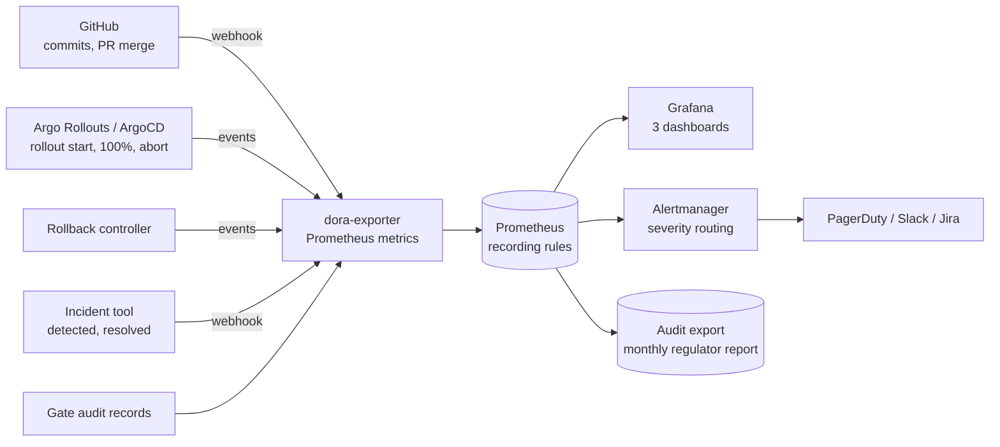

# Deliverable 8: Observability, DORA Metrics and Dashboards

**Author:** Manyashree U | **Rules:** [dora-recording-rules.yaml](dora-recording-rules.yaml), [rollback-rules.yaml](../06-rollback-specification/alerts/rollback-rules.yaml) | **Routing:** [alertmanager.yml](alerting/alertmanager.yml) | **Dashboards:** [Grafana JSON](../../dashboards/grafana/), [wireframes](../../dashboards/mockups/) | **Generator:** [generate-dashboards.py](../../pipeline/scripts/generate-dashboards.py)

## 1. Why this matters
NovaPay today has *zero observability*: incidents are detected by customers, not systems. YES Bank's UPI failures went unseen for the same reason (Case Study 2 in the project brief). The target is that systems detect a production fault **before customers notice**, within 30 seconds for payment failures, and that every compliance control produces measurable evidence.

Stack (from the project scenario): Prometheus + Grafana (metrics), OpenTelemetry (traces), Loki (logs), Alertmanager (routing), Sloth/Pyrra (SLOs), Grafana Synthetic Monitoring or blackbox exporter (end-user view, the SBI YONO lesson).

Source: [dora-data-flow.mmd](diagrams/dora-data-flow.mmd)

## 2. DORA metrics: design and measurement
| DORA metric | Definition | Elite target (brief) | NovaPay design target | Measurement method |
|-------------|-----------|---------------------|----------------------|--------------------|
| **Deployment frequency** | How often code reaches production | Multiple per day | 10+ per day across services | Count of successful production rollouts per day (`novapay_deployments_total{env="production",status="success"}`) |
| **Lead time for changes** | Commit to production deployment | < 1 hour | Standard lane < 2 h; fast lane < 1 h (section 3) | Timestamp difference: first commit of the change to the rollout reaching 100% (`novapay_lead_time_seconds` histogram; report p50 and p90) |
| **Change failure rate** | % of deployments causing failures | < 5% | < 5% | (Rollbacks + hotfixes + incident-linked deployments) / total deployments |
| **MTTR** | Time to restore after failure | < 1 hour | < 15 min (project target) | Incident duration: detection to resolution (`novapay_incident_resolution_seconds`) |

Queries: [dora-recording-rules.yaml](dora-recording-rules.yaml) (recording rules and three regression alerts).

**Measurement methodology**
1. **One event source per fact.** Commit time from GitHub, rollout events from Argo Rollouts, rollback events from the rollback controller, incident times from the incident tool. A small `dora-exporter` turns these webhooks into Prometheus metrics, so DORA numbers are computed from system events, never typed in by hand.
2. **Change identity.** Every deployment carries the commit SHAs it contains (from the change record), so lead time is computed per change, not per deployment.
3. **What counts as a failure.** A deployment is "failed" if it was rolled back (any category), needed a hotfix within 24 h, or is linked to a SEV-1/SEV-2 incident. This makes the change-failure rate honest, because automated rollback cannot hide failures.
4. **MTTR clock.** Starts at the first alert (detection), stops when verification passes after mitigation, so rollback speed is directly visible.
5. **Segmentation.** Metrics are sliced by service and by lane (standard / fast / hotfix) so averages do not hide the risky services.

> **Note on "elite".** The brief's table uses < 1 h for lead time and recovery. Recent DORA research bands use less than one day for lead time (elite) and less than one hour for failed-deployment recovery. This design is measured against the brief's stricter figures and also meets the less strict ones. Confirm which version your evaluator uses.

## 3. Lead time: reaching the brief's elite target
The standard pipeline ([Deliverable 1, section 5](../01-pipeline-architecture/architecture.md)) delivers about **1 h 46 min** commit-to-production, which meets the project's < 2 h target but **not** the < 1 h elite figure. To get there for low-risk changes, a **fast lane** is defined for pre-approved change categories ([Deliverable 5](../05-environment-promotion/environment-promotion.md)): configuration-only changes, dependency patch updates that pass all gates, and feature-flag changes.

| Step | Fast lane (min) | Cumulative |
|------|-----------------|-----------|
| Trigger, build, parallel scans, integration tests | 19 | 19 |
| Publish, sign, deploy to staging | 4 | 23 |
| Passive DAST baseline (5) in parallel with performance test (10) | 10 | 33 |
| Policy gates | 3 | 36 |
| Dual approval requested in parallel (Release Manager + SRE Lead, SLA 5 min each, no CAB meeting); automated pre-prod verification runs in parallel | 5 | 41 |
| Compressed canary 2% / 10% / 100% (4 + 5 + 5 min) plus verification | 15 | **56** |

The fast lane still runs every gate and keeps dual approval; it removes the sequential human waits, the full active DAST scan (replaced by the nightly one), and the longer canary profile. These are estimates and must be validated by measuring real runs (the `novapay_lead_time_seconds` p50 by lane). Where the measured value is above target, the dashboard shows it in amber or red.

## 4. SLO design
| SLI | SLO | Error budget | Use |
|-----|-----|-------------|-----|
| Request success (non-5xx) | 99.99% over 30 days | 0.01% | Burn-rate alerts and rollback trigger B2 (> 10x burn) |
| Availability (synthetic probe from outside the cluster) | 99.999% (five nines, about 5.3 min of downtime per year) | Per year | Reported to management; achieved through redundancy, zero-downtime deployment and multi-AZ |
| Payment success ratio | Within 2 points of the 7-day baseline | n/a | Rollback trigger B3 |
| p99 latency | < 200 ms (canary), < 500 ms under 2x load | n/a | Canary analysis and trigger B1 |

Sloth or Pyrra generates the multi-window burn-rate rules from these SLO definitions.

## 5. Pipeline-specific metrics (20)
Build, compliance and deployment categories. The table below is generated from the same definition as the dashboards, so the names match.

| # | Metric | Category | Definition | Source | Target | Alert |
|---|--------|----------|------------|--------|--------|-------|
| 1 | `novapay_ci_builds_total{result}` | Build | Build success rate = success / all builds | GitHub Actions webhook exporter | > 95% | < 90% over 1 d |
| 2 | `novapay_ci_test_flaky_total / novapay_ci_tests_total` | Build | Flaky test rate: tests that failed then passed on retry | Test report parser | < 1% | > 2% over 7 d |
| 3 | `topk(10, novapay_ci_test_flaky_total{test})` | Build | Top 10 flaky tests (quarantine candidates) | Test report parser | Zero tests flaky twice in 7 d | Any test flaky twice -> ticket |
| 4 | `novapay_ci_cache_hits_total / (hits + misses)` | Build | Gradle + Docker layer cache hit rate | Build logs | > 80% | < 60% over 1 d |
| 5 | `novapay_ci_pr_feedback_seconds` | Build | Developer feedback loop: PR push to first full result (p50) | GitHub API | < 10 min | p50 > 15 min |
| 6 | `novapay_ci_queue_seconds` | Build | Time a job waits for a runner (p90) | GitHub Actions | < 2 min | p90 > 5 min |
| 7 | `novapay_ci_coverage_ratio{type}` | Build | Line and branch coverage on main | JaCoCo / SonarQube | >= 80% line, >= 70% branch | Any drop of > 2 points |
| 8 | `novapay_gate_results_total{gate,result}` | Compliance | Gate pass rate per gate type (SAST, DAST, dependency, licence, policy, infra, SoD, provenance) | Gate audit records | > 90% first-time pass | < 80% for any gate |
| 9 | `novapay_scan_false_positives_total{tool} / novapay_scan_findings_total{tool}` | Compliance | False-positive rate per scanning tool (SonarQube, ZAP, Trivy) | Triage workflow | < 10% | > 20% (tune rules) |
| 10 | `novapay_vulns_open{severity}` | Compliance | Open vulnerabilities and median age by severity | Trivy / SonarQube | 0 Critical; High < 7 days | Any Critical |
| 11 | `novapay_exceptions_active{gate}` | Compliance | Active gate exceptions and those expiring within 7 days | Exception register | < 5 total | Any expired and still in use |
| 12 | `novapay_images_signed_ratio, novapay_sbom_coverage_ratio` | Compliance | Share of running images that are signed / have an SBOM | Kyverno + registry | 100% | < 100% |
| 13 | `novapay_audit_records_total / novapay_deployments_total` | Compliance | Audit-record completeness per production deployment | Audit store | 100% | < 100% |
| 14 | `novapay_sod_violations_total` | Compliance | Segregation-of-duties violations | SoD gate | 0 | Any |
| 15 | `novapay_deploy_duration_seconds` | Deployment | Rollout duration from first canary step to 100% | Argo Rollouts | < 40 min standard | > 60 min |
| 16 | `novapay_canary_outcomes_total{outcome}` | Deployment | Canary promotion success rate (promoted vs rolled back) | Argo Rollouts | > 95% promoted | < 90% over 30 d |
| 17 | `novapay_rollbacks_total{category,trigger}` | Deployment | Rollback frequency and trigger distribution | Rollback controller | < 5% of deployments | > 10% over 30 d |
| 18 | `novapay_deploy_blocked_total{reason}` | Deployment | Deployments held by the blackout calendar or deploy freeze | Pipeline | Informational | n/a |
| 19 | `novapay_drift_events_total{env}` | Deployment | Configuration drift events detected by ArgoCD | ArgoCD notifications | 0 in production | Any production drift |
| 20 | `novapay_approval_wait_seconds{stage}` | Deployment | Time spent waiting for a human approval | GitHub Environments | < 10 min | > 30 min |

## 6. Dashboards
Wireframes (SVG) in [dashboards/mockups](../../dashboards/mockups/) and importable Grafana JSON in [dashboards/grafana](../../dashboards/grafana/) (queries are real PromQL against the metric names above; the JSON is a mockup until the exporters exist). Import via Grafana: Dashboards, New, Import, upload JSON, choose the Prometheus data source.

| Dashboard | Audience | Content | Refresh |
|-----------|----------|---------|---------|
| **Engineering** ([JSON](../../dashboards/grafana/engineering-dashboard.json), [wireframe](../../dashboards/mockups/engineering-wireframe.svg)) | SRE, on-call, developers (real-time operations) | Error ratio, p99 vs baseline, payment success, canary traffic split, firing alerts by category, rollbacks (24 h), deploy-freeze flag, DB pool pressure, gate pass rate, CI queue time | 30 s |
| **Management** ([JSON](../../dashboards/grafana/management-dashboard.json), [wireframe](../../dashboards/mockups/management-wireframe.svg)) | CTO, VP Engineering (weekly/monthly) | Four DORA stats, deployments-per-week trend, synthetic availability, error-budget remaining, open vulnerabilities, rollback trigger mix | 5 min |
| **Regulatory** ([JSON](../../dashboards/grafana/regulatory-dashboard.json), [wireframe](../../dashboards/mockups/regulatory-wireframe.svg)) | Head of Compliance, RBI auditor (audit-ready) | Gate results per release, audit-record completeness, SoD violations (must be 0), dual-approval ratio, exception register and expiries, signed-image and SBOM coverage, incidents over 30 min, audit-write failures | 15 min |

The regulatory dashboard is designed so an auditor can answer *"prove this change was tested, scanned, approved and traceable"* without asking engineering. It exports monthly to a read-only report, supporting RBI 6.1 and PCI-DSS 10.2.

## 7. Alerting strategy
Routing configuration: [alertmanager.yml](alerting/alertmanager.yml).

| Severity | Typical source | Who is notified | Channel | Updates |
|----------|---------------|-----------------|---------|---------|
| **SEV-1** (Category A, total outage, data-integrity risk) | Rollback rules A1-A5 | On-call SRE, escalating to SRE Lead, then CTO + CISO + VP Eng | PagerDuty + #novapay-incidents + executive bridge | Every 30 min |
| **SEV-2** (Category B, > 10% users) | Rollback rules B1-B4 | On-call SRE, VP Eng + SRE Lead | PagerDuty + Slack | Hourly |
| **SEV-3** (Category C, minor degradation) | Drift and downstream-correlation alerts | SRE on-call + Tech Lead (working hours) | Slack | Every 4 h |
| **SEV-4** (cosmetic, DORA regressions) | Dashboards and DORA alerts | Assigned engineer | Jira ticket | Next business day |

**Design rules**
- **Page on symptoms, not causes**: error ratio, latency, payment success, burn rate. Cause-level alerts (CPU) are tickets unless they threaten the SLO.
- **Inhibition:** a Category A alert (already rolling back) silences the B/C alerts for the same namespace, to prevent alert storms at 3 AM.
- **Every alert has a runbook link** in its annotations ([incident playbook](../../runbooks/incident-playbook.md)).
- **Escalation:** unacknowledged pages move up the PagerDuty policy; rollback triggers B start the 10-minute acknowledgement timer in the rollback controller ([Deliverable 6](../06-rollback-specification/rollback-specification.md)).
- **On-call burden** (the SRE team's concern): automation handles Category A with no human; alert noise is tracked (pages per week per engineer) and reviewed monthly.
- **Secrets** (PagerDuty keys, Slack webhooks) are read from files mounted from Vault, never stored in the config.

## 8. Regulatory incident reporting
Incidents that last longer than 30 minutes trigger the regulatory notification workflow (Compliance decides and files; see the [incident playbook](../../runbooks/incident-playbook.md)). The counter `novapay_incident_over_30m_total` on the regulatory dashboard makes these visible. Confirm the current RBI and CERT-In reporting timelines with Compliance before the TRC presentation.

## 9. Links
[Architecture](../01-pipeline-architecture/architecture.md) | [Rollback](../06-rollback-specification/rollback-specification.md) | [Compliance gates](../03-compliance-gates/compliance-gates.md) | [Runbook](../../runbooks/deployment-runbook.md)

> **AI Attribution:** Drafted with AI assistance (Claude, Anthropic). Author review: Manyashree U.
