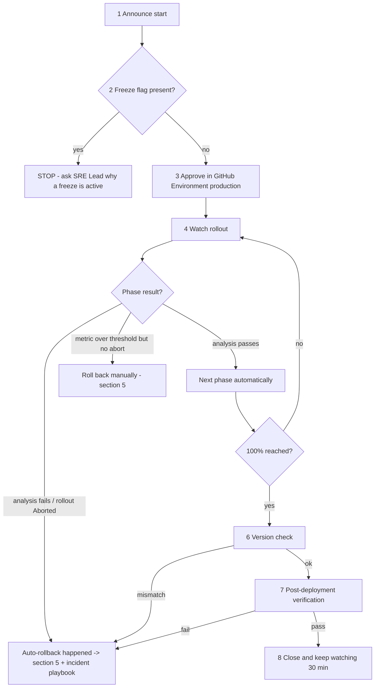

# NovaPay Production Deployment Runbook

**Owner:** SRE Lead | **Audience:** on-call engineer at 3 AM with minimal context | **Related:** [Incident playbook](incident-playbook.md), [Rollback specification](../docs/06-rollback-specification/rollback-specification.md), [Deployment strategies](../docs/02-deployment-strategies/deployment-strategies.md)

> **If something is going wrong right now, jump to [section 5: Rollback in 60 seconds](#5-rollback-in-60-seconds).** Rolling back is always allowed and never needs approval.

## 0. What a deployment is
A new signed image is promoted to production by **canary** (normal) or **blue-green** (settlement/stateful releases). The pipeline does the work; your job is to confirm the checklist, approve, watch the numbers, and roll back if they go wrong. Placeholders: `<…>`. Namespace `novapay-prod`, rollout `novapay-app`.

## 1. Pre-deployment checklist (all 8 must be YES, evidence attached to the change record)
| # | Check | How to verify | Evidence required |
|---|-------|---------------|-------------------|
| 1 | **Change approved**: dual approval (Release Manager AND SRE Lead), and CAB approval or a pre-approved change category | GitHub Environment `production` shows two approvals from two different people, neither the author | Change record ID + approval link |
| 2 | **All compliance gates passed** for this run | Regulatory dashboard, gate results for run `<run-id>`: SAST, DAST, dependency, licence, policy, infra, SoD, provenance all pass (or pass with a valid exception id) | Link to the 8 audit records |
| 3 | **Same artefact** as pre-prod | `./pipeline/scripts/check-same-artifact.sh <staging-values> <preprod-values> <prod-values>` prints `OK` | Command output |
| 4 | **Deployment window is open** | `./pipeline/scripts/check-deploy-window.sh` prints `Deployment window OK` (no peak hours 10-12 and 17-20 IST, no salary days 1/7/15, no month-end 28-31, no festival or RBI settlement blackout) | Command output |
| 5 | **Database is ready** | If the release has a migration: expand phase already applied, backfill verification = 0 rows, backup / point-in-time recovery confirmed in the last 24 h, DBA sign-off. No contract (drop) step in this release | Flyway history + backup timestamp + DBA approval |
| 6 | **Rollback is ready** | `kubectl argo rollouts get rollout novapay-app -n novapay-prod` shows the previous revision available; you can run `pipeline/scripts/emergency-rollback.sh` (kubectl access confirmed) | Screenshot of revision list |
| 7 | **Monitoring is ready** | Engineering dashboard open; no active silences in Alertmanager; synthetic probes green; no firing alerts; `deploy-freeze` ConfigMap absent | Screenshot of dashboard + empty silence list |
| 8 | **People are ready** | On-call engineer confirmed and briefed; Incident Commander named; #novapay-deployments channel open; SRE Lead reachable | PagerDuty schedule screenshot + acknowledgement message |

**Any NO means STOP.** Do not deploy. Post the failed item in #novapay-deployments and tell the Release Manager.

## 2. Execution procedure (canary)


| Step | Action | Command / where | Decision |
|------|--------|-----------------|----------|
| 1 | Announce start | Post the "deployment started" message in #novapay-deployments | - |
| 2 | Check for a freeze | `kubectl -n novapay-prod get configmap deploy-freeze` | If it exists: **STOP** (a rollback happened recently). If "NotFound": continue |
| 3 | Approve | GitHub, Environments, production, Review deployments (Release Manager and SRE Lead each approve) | Pipeline now updates the GitOps repo and ArgoCD syncs |
| 4 | Watch the rollout | `kubectl argo rollouts get rollout novapay-app -n novapay-prod --watch` and the Engineering dashboard | See the phase table below |
| 5 | At each phase, check the numbers | Dashboard: error ratio, p99, payment success | Thresholds below. Over threshold with no auto-abort: **roll back manually** |
| 6 | Version check at 100% | `./pipeline/scripts/verify-deployment.sh novapay-prod <image-ref>` | Must print 1 distinct digest. Mismatch: **roll back** |
| 7 | Verify | Section 3 | Any failure: **roll back** |
| 8 | Close | Post "deployment complete" message, update the change record, keep watching 30 min; 24 h bake continues automatically | If an alert fires in the bake period: section 5 |

**Phase thresholds (standard profile)**
| Phase | Traffic | Duration | Must hold |
|-------|---------|----------|-----------|
| 1 | 2% | 10 min | Error ratio < 0.1%, p99 < 200 ms, analysis passing |
| 2 | 10% | 10 min | Error ratio < 0.05%, no critical alerts |
| 3 | 50% | 15 min | All SLOs met, no degradation vs baseline |
| 4 | 100% | 5 min | Same, then 24 h bake |
For risk-tagged changes the full profile applies (15 / 30 / 60 min).

## 3. Post-deployment verification
| # | Check | How | Expected outcome |
|---|-------|-----|------------------|
| 1 | Every pod healthy | `kubectl -n novapay-prod get pods -l app=novapay-app` | All `Running`, `READY 1/1`, no restarts increasing |
| 2 | Single version | `verify-deployment.sh` | **1** distinct image digest, equal to the release digest |
| 3 | Health endpoints | `curl -s https://api.novapay.example/actuator/health` | `{"status":"UP"}` |
| 4 | Smoke tests | Pipeline smoke suite: login, balance enquiry, UPI collect (sandbox) | 100% pass |
| 5 | Synthetic transactions | Synthetic monitor panel | All green for 10 consecutive minutes |
| 6 | Error ratio | Engineering dashboard | < 0.1% and not above the pre-release value + 10% |
| 7 | p99 latency | Dashboard | < 200 ms and within 10% of baseline |
| 8 | Payment success ratio | Dashboard | Within 1 point of baseline |
| 9 | No new alerts | Alertmanager | None firing for this service |
| 10 | Argo status | `kubectl argo rollouts status novapay-app -n novapay-prod` | `Healthy` |

## 4. Blue-green variant
1. Confirm the idle colour has the new version and all pods Ready.
2. Run smoke tests through the preview route (`x-novapay-preview: true` header).
3. Approve the switch. The pipeline flips the VirtualService weights.
4. Watch error ratio and p99 for 30 min. Old colour stays warm for 24 h.
5. **Revert:** `TARGET_COLOUR=<old colour> ./pipeline/scripts/emergency-rollback.sh bluegreen "reason"`.

## 5. Rollback in 60 seconds
**You do not need permission to roll back.** Tell the Release Manager afterwards.
```
./pipeline/scripts/emergency-rollback.sh canary "<one-line reason>"
```
It freezes promotions, pauses ArgoCD auto-sync, aborts (or undoes) the rollout and verifies the version. If the script fails, run by hand:
```
kubectl argo rollouts abort novapay-app -n novapay-prod      # rollout still in progress
kubectl argo rollouts undo  novapay-app -n novapay-prod      # already at 100%
```
Then: post the "rollback" message, open an incident ([playbook](incident-playbook.md)), and do **not** redeploy the same version until the freeze is cleared by the SRE Lead.

## 6. Troubleshooting
| Symptom | Likely cause | Action |
|---------|--------------|--------|
| Pipeline waits at "production" forever | Only one approver, or the author approved their own change | Get the second distinct approver (Release Manager + SRE Lead) |
| `check-deploy-window.sh` fails | Peak hour or blackout day | Do not override; reschedule. Emergency change: hotfix path in the incident playbook |
| ArgoCD shows OutOfSync right after rollback | Auto-sync was paused on purpose | Merge the Git revert, then re-enable auto-sync (`kubectl -n argocd patch application novapay-production --type merge -p '{"spec":{"syncPolicy":{"automated":{"prune":true,"selfHeal":true}}}}'`) |
| Pods `ImagePullBackOff` | Registry or credentials problem | Check the image digest exists in Artifactory; escalate to SRE Lead. Do not switch to `latest` |
| Pods rejected at admission | Kyverno: unsigned image or missing SBOM attestation | The image did not come from the pipeline. Stop and escalate to the CISO |
| Canary stuck at one weight | Analysis run still collecting data or paused step | Wait for the pause duration; check `kubectl argo rollouts get rollout` for the analysis status |
| `verify-deployment.sh` shows 2 digests | Mixed versions: rollout incomplete or a stale pod | Treat as a failure (Knight Capital pattern): roll back |

## 7. Escalation
| When | Who |
|------|-----|
| Anything unclear | On-call SRE, then **SRE Lead** |
| SEV-2 or worse | Follow the [incident playbook](incident-playbook.md) escalation path |
| Approval or window question | Release Manager |
| Security concern (unsigned image, unexpected access) | CISO |
Phone numbers and handles are kept in the PagerDuty schedule, not in this document.

## 8. Records to keep
Change record ID, approvals, gate audit records (auto-attached), command outputs from sections 1 and 3, timestamps for each step, and any rollback record. They form the evidence pack for RBI 6.1 and PCI-DSS 10.2.

> **AI Attribution:** Drafted with AI assistance (Claude, Anthropic). Author review: Manyashree U.
